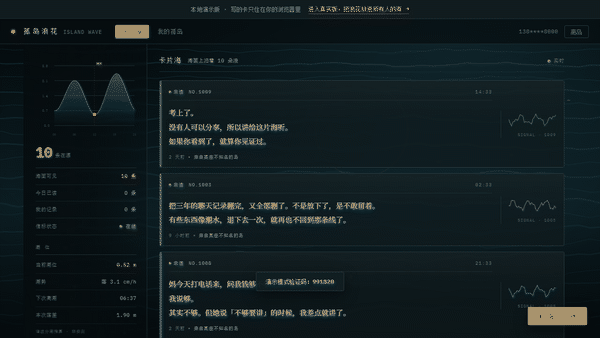

## ✨ 孤岛浪花 v2.0.0 · 夜航信号与活海

> 每个人都是一座孤岛。把想说的话写成卡片，它会变成一朵浪花，漂进某一片海，
> 被某一个人看到一次，然后永远退去。

v1.0.0 之后的一周里，这个项目从「一个能跑的匿名卡片 demo」长成了「一台夜间的海面观测站」。

**在线访问**
- 完整版（登录后放卡入海）：https://island-wave-cards.app.workbuddy.host/?sharecode=R7PJGFFCEZ
- 分享给别人请用[登岛入口](https://cry-88.github.io/island-wave-cards/entry.html)（无参短链，截断也能打开）
- 零门槛试玩（演示版）：https://cry-88.github.io/island-wave-cards/

---

### 🎨 主界面重做：夜航信号

- 整体视觉从浅色卡片瀑布流改为**深色海面观测站**：海是船体黑，卡片是舱室灰，
  唯一的强调色是只标「此刻」的信号琥珀。
- 字体分工明确：**人说的话用衬线字，系统记的账用等宽字**，一眼分清哪句是卡片、哪句是读数。
- 左侧新增仪表台：潮位曲线、可见条数、今日已读、我的记录、信标状态。
- 卡片不再只是淡出，而是**信号衰减**——模糊、失色、横移、消散。

### 🌊 背景是一片活海

- 新增 `frontend/sea.js`：等深线、计曲线、浮沫、雷达灯扫、涟漪，形态取自海图（bathymetric chart）语言。
- 新增 `frontend/tide.js`：**全站唯一的潮汐真源**，五分潮谐波叠加（M2/S2/N2/K1/O1），
  相位锚定 `2000-01-01 UTC` 历元。
- 仪表和背景**同源**：潮位决定浪高，潮势决定流向与速度，落差决定涌浪规模；
  卡片被读走、水面拍岸都会在海面激起涟漪。
- `prefers-reduced-motion` 降级为静态帧；无 Canvas 时安静退场。

### 🚢 真实版上线

- 云服务配置填入，`index.html` 成为站点主入口，demo 版移至 `/demo.html`。
- 修复 Pages 根入口与云端 Origin 白名单冲突的问题。
- 手机号验证码登录 + 微信 OAuth 登录（回调带 `sharecode`）。

### 🔗 链接被截断也能自救

- 新增无参登岛入口 `entry.html`：运行时读取配置拼出真实版完整链接，3 秒自动跳转（可取消）。
- 分享按钮复制的一律是无参入口页地址，因此**微信/聊天软件截断链接也不会打不开**。
- 修复：门禁在 HTTP 层替换整页，前端脚本不会执行，所以自跳转方案不可行——改为入口页方案。

### 🧪 工程

- 冒烟测试断言从 73 项增至 **91 项**，覆盖入口页 → 真实版 → 登录控件完整链路。
- 新增 `tools/capture-gif.js`（CDP 连续抓帧生成 GIF）、`tools/verify-entry.js`（端到端验证）。
- 修掉一条依赖真实潮汐相位的 flaky 断言，改为确定性断言。
- CI 补齐 `tide.js` / `sea.js` / `entry.html` 的拷贝清单（漏任一个都会白屏）。

---

📖 完整改动记录见 [CHANGELOG.md](https://github.com/cry-88/island-wave-cards/blob/main/CHANGELOG.md)

**本版贡献者** [@cry-88](https://github.com/cry-88) · MIT License
