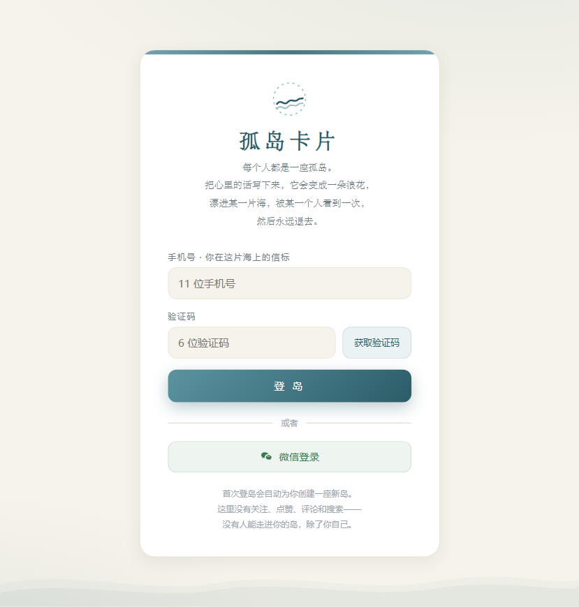
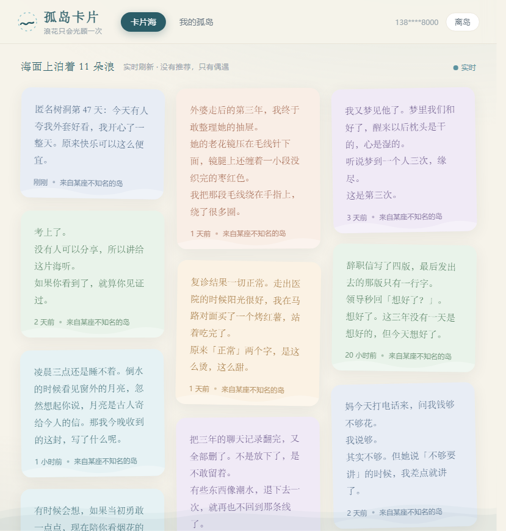

# 孤岛浪花 · island-wave-cards

> 每个人都是一座孤岛。把想说的话写成卡片，它会变成一朵浪花，漂进某一片海，
> 被某一个人看到一次，然后永远退去。

一个供人倾诉与记录的**匿名卡片网站**：没有关注、点赞、评论、搜索，没有推荐算法，
只有实时刷新里的偶遇。你点开一张卡片看完它，它就从你的海面永远消失——
你不知道它来自哪座岛，它也不会再来。只有你自己，能回到自己的岛看往日写下的字。





## 在线演示

👉 **[直接打开 Demo](https://cry-88.github.io/island-wave-cards/)** — GitHub Pages 部署的可交互演示版（数据存在浏览器本地，刷新不丢失）。

## 目录结构

```
island-wave-cards/
├── frontend/               # 前端（零依赖静态站，无需构建）
│   ├── index.html          #   入口页：登录 / 卡片海 / 我的孤岛 / 发布弹窗
│   ├── demo.html           #   本地演示版（引用 local-backend.js，无需云端）
│   ├── styles.css          #   海面与宣纸风格样式
│   ├── app.js              #   前端逻辑：登录守卫、卡片海、一次性可见、发布
│   ├── config.js           #   云端公共配置（公开标识，非密钥）
│   └── local-backend.js    #   本地演示后端（localStorage 模拟云端 API）
├── backend/                # 本地静态服务器（零依赖，仅用于本地预览/托管）
│   ├── server.js
│   └── package.json
├── assets/                 # README 截图
├── .github/workflows/      # GitHub Pages 自动部署
├── .gitignore
├── LICENSE
└── README.md
```

## 快速开始

**方式一：直接双击打开 `frontend/demo.html`** — 纯前端演示版，数据存在浏览器 localStorage 里，无需任何服务器或云端配置。

方式二：启动本地服务器——

```bash
cd backend
npm start          # 默认 http://localhost:3000，可用 PORT=8080 覆盖
```

> 注意：`frontend/index.html` 是生产版入口，需要配置 WorkBuddy Cloud 云端后端（`config.js` 中的 `endpoint` 和 `publishableKey`）才能运行。如果你只是想体验效果，用 `demo.html`。

## 架构说明

- **前端是纯静态站点**（HTML/CSS/JS，无框架、无构建步骤），通过 CDN 引入
  WorkBuddy Cloud SDK，直连托管云服务。
- **真实后端是托管云服务**（Database + Auth），不在本仓库内：
  - `cards` 表：每条文字一朵浪；`card_seen` 表：某位读者已看过的卡片。
  - **「看过即消失」由数据库 RLS 策略在服务端强制执行**——`cards` 的读取策略嵌有
    `NOT EXISTS` 子查询，你看过的卡连查询结果都进不来，不是前端藏起来。
  - `card_seen` 仅本人可读写（隐私：无人能查谁看过什么）；未登录用户完全锁死。
  - `owner_id` 由数据库 `DEFAULT auth.uid()` 写入，客户端绝不发送。
- **登录**：手机号验证码（默认）+ 微信登录。
- `frontend/local-backend.js` 是一个可选的本地演示后端：用 localStorage 模拟同一套
  API（含服务端「看过即消失」过滤与其他岛漂卡的模拟器），让没有云端时也能完整体验。
  线上版不引用它。

## 安全说明

- `.env` 系列文件、`*.db` / `*.sqlite3` 数据库文件已被 `.gitignore` 强制拦截，
  **严禁**绕过过滤提交。
- `frontend/config.js` 中的 `publishableKey` 是**公开标识**：本身不带任何权限，
  服务端还会校验 Origin，可安全出现在前端代码中（线上页面源码里本来就有）。
  它不是密钥，但也请注意：要部署自己的实例，请替换为你自己应用的配置。

## License

[MIT](LICENSE) © RuYi Chen
