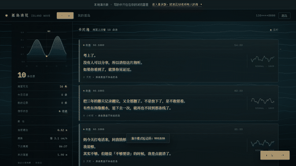
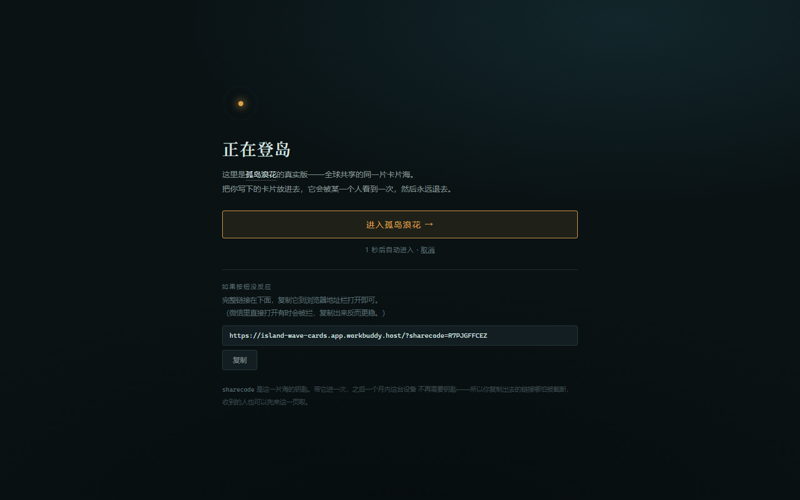

# 孤岛浪花 · island-wave-cards

> 每个人都是一座孤岛。把想说的话写成卡片，它会变成一朵浪花，漂进某一片海，
> 被某一个人看到一次，然后永远退去。

一个供人倾诉与记录的**匿名卡片网站**：没有关注、点赞、评论、搜索，没有推荐算法，
只有实时刷新里的偶遇。你点开一张卡片看完它，它就从你的海面永远消失——
你不知道它来自哪座岛，它也不会再来。只有你自己，能回到自己的岛看往日写下的字。


## 视觉：夜航信号

整个界面是一台**夜间的海面观测站**：

- **人说的话用衬线字**（宋体系，系统自带，零加载成本），**系统记的账用等宽字**
  （IBM Plex Mono）——一眼能分清哪句是卡片、哪句是读数。
- **配色只有六支**：船体黑（海）、舱室灰（卡片）、骨架线、浪沫白（正文）、
  刻度灰（次要信息）、**信号琥珀（唯一强调色，只标"此刻"）**，外加一个活体绿标"未读"。
- **左侧是仪表台**：潮位曲线、可见条数、今日已读、我的记录、信标状态；
  右侧是信流，每条卡片带 `NO.` 编号、精确到分钟的靠岸时刻、一条代表分类的潮色脊。
- **卡片读走时不是简单淡出**，而是"信号衰减"——模糊、失色、横移、消散，
  像浮标的讯号在噪声里沉下去。

## 背景是一片活海

主界面的背景不是贴上去的装饰动画，**它就是主界面所在的那片海**——
由 `frontend/sea.js` 用 Canvas 实时绘制，形态取自海图（bathymetric chart）的语言：
等深线、每第 4 根加粗的计曲线、浮沫、以及每隔十几秒扫过海面的信号灯。



> 上面的动图是主界面的实时录屏（20 帧连拍，非后期合成）：
> 等深线在缓慢流动、浮沫在明灭、信号灯每十几秒扫过一次海面，
> 卡片从这片海里漂过。静态截图看不出这一点，所以这里放的是 GIF。

关键在于**它和左栏仪表读的是同一份数据**（`frontend/tide.js` 是全站唯一的潮汐真源）：

| 潮汐数据 | 背景海面的表现 |
| --- | --- |
| 当前潮位 | 浪有多高、浮沫有多少 |
| 潮势（涨/落 cm/h） | 水流往哪边走、走多快；平潮时海面几乎静止 |
| 本次落差 | 与浪高共同决定涌浪的规模 |

潮汐模型按真实半日潮推算（`M2 / S2 / N2 / K1 / O1` 五个分潮谐波叠加），
相位锚定在固定历元上，所以**潮位跟着世界时钟涨落**，同一时刻所有人看到的是同一片海。

还有一处联动：**卡片被读走、退场的那一刻，它在海图上会留下一圈荡开的涟漪**——
"看过即消失"这件事，在背景上是真的看得见的。

无障碍：`prefers-reduced-motion` 下自动降级为静态一帧；页面切到后台时暂停渲染。

### 登岛入口：分享链接为什么是「无参」的

托管域上有一道平台层的**访问门禁**：请求必须带对 `sharecode` 参数，
否则整页会被换成 403「链接不完整」的拦截页——那页里连登录按钮都没有，
所以拿到截断链接的人会觉得「点不了验证码、也点不了微信登录」。

而 `sharecode` 只能待在 query 里，query 恰恰是聊天工具转发时最容易截断的部分。

于是有了 `frontend/entry.html`：它挂在 GitHub Pages 上（那里没有门禁），
**URL 一个参数都没有**，截断无从发生；完整链接由脚本在运行时拼出来，
再把人送进真实版。3 秒内没点任何东西就自动跳，点「复制」或「取消」则收回自动跳转。



登岛页还有个「复制这片海的链接」按钮，复制的就是这个无参入口页——
**发给别人请用这个**，不要直接复制地址栏。

### 想自己看一眼？

```bash
node tools/capture-gif.js    # 用 CDP 直连 Edge 连拍 48 帧，输出到 assets/_frames
```

动图不是录屏工具的产物，是脚本按固定间隔连拍出来的——
所以每一帧都来自**同一个页面实例**，卡片内容和海面相位连续，不会跳帧。
（同一份素材见 `assets/screenshot-sea.gif`；合成 GIF 需要 Python + Pillow，
只有想重新生成时才用得上，日常开发不需要。）

想验证登岛链路真的走得通（而不是只看单个 URL 返回什么）：

```bash
node tools/verify-entry.js   # 真实浏览器跑完整链路：入口页 → 自动跳转 → 登录页控件就位
```

它用 CDP 驱动一个真实 headless Edge，打开无参入口页、等自动跳转发生，
再检查落点是否带上了 `sharecode`、登录页的三个控件是否都在。
改了入口页或门禁相关的逻辑后跑一遍，比 curl 靠谱。

## 在线访问

- **[孤岛浪花 · 登岛入口](https://cry-88.github.io/island-wave-cards/entry.html)** —— **分享给别人请用这个**。完整版：手机号 / 微信登录后放卡入海，偶遇陌生人的浪花，看过即消失。
- **[孤岛浪花 · 本地演示版](https://cry-88.github.io/island-wave-cards/)** —— GitHub Pages，零门槛试玩：无需登录，数据存在浏览器本地。

> 为什么分享要用「登岛入口」而不是真实版直链：
>
> 托管域上有一道**平台层的访问门禁**——请求里必须带对 `sharecode` 参数，
> 否则整页会被换成 403「链接不完整」的拦截页（那页里连登录按钮都没有）。
> 而 `sharecode` 只能待在 query 里，query 恰恰是聊天工具转发时最容易截断的部分。
>
> 登岛入口挂在 GitHub Pages 上（那里没有门禁），它的 URL **一个参数都没有**，
> 截断无从发生；完整链接由脚本在运行时拼出来，再把人送进真实版。
> 门禁还会种一枚 Cookie（`__wb_rsc`），带对一次之后一个月内该设备免检。
>
> 顺带一提：真实版的微信登录回调地址也带上了 `sharecode`。
> 之前 `redirectTo` 是裸域名，授权完跳回来会撞上门禁——现在这条链路是通的。

> 为什么真实版不住 GitHub Pages：托管云服务会校验请求来源（Origin 白名单），
> GitHub Pages 域名不在其中，真实版放上去能打开但无法登录。演示版用
> localStorage 模拟同一套 API，不受影响——所以 Pages 根入口放的是演示版，
> 并在页面顶部放了通往真实版的入口。

## 目录结构

```
island-wave-cards/
├── frontend/               # 前端（零依赖静态站，无需构建）
│   ├── index.html          #   入口页：登录 / 卡片海 / 我的孤岛 / 发布弹窗
│   ├── demo.html           #   本地演示版（引用 local-backend.js，无需云端）
│   ├── entry.html          #   登岛入口（分享用）：无参短链，运行时拼出真实版地址
│   ├── styles.css          #   夜航信号风格样式（配色变量集中在 :root）
│   ├── tide.js             #   潮汐模型：全站唯一真源（五个分潮谐波叠加）
│   ├── sea.js              #   背景活海引擎：Canvas 绘制等深线 / 灯扫 / 浮沫 / 涟漪
│   ├── app.js              #   前端逻辑：登录守卫、卡片海、一次性可见、发布
│   ├── config.js           #   云端公共配置 + sharecode / 入口页地址
│   └── local-backend.js    #   本地演示后端（localStorage 模拟云端 API）
├── backend/                # 本地静态服务器（零依赖，仅用于本地预览/托管）
│   ├── server.js
│   └── package.json
├── test/                   # 集成冒烟测试（jsdom 驱动 demo 版全流程）
│   └── smoke.js
├── tools/                  # 开发辅助脚本
│   ├── capture-gif.js      #   活海背景动图抓帧器（CDP 直连 Edge 连拍）
│   └── verify-entry.js     #   登岛入口端到端验证（CDP 跑完整跳转链路）
├── design/                 # 视觉方向原型（三版对比稿，供设计决策留档）
├── assets/                 # README 截图与动图
├── .github/workflows/      # GitHub Pages 自动部署
├── CHANGELOG.md            # 更新日志（v1.0.0 / v2.0.0）
├── .gitignore
├── LICENSE
└── README.md
```

## 快速开始

**方式一：直接双击打开 `frontend/demo.html`** — 纯前端演示版，数据存在浏览器 localStorage 里，无需任何服务器或云端配置。

方式二：启动本地服务器——

```bash
cd backend
npm start          # 默认 http://localhost:3000，可用 PORT=8080 覆盖
```

> 注：`frontend/config.js` 已填入「孤岛浪花」应用（2026-11-03 激活）的真实云服务配置，线上真实版开箱即用；`demo.html` 仍可零门槛试玩。

## 测试

改动前端后可以跑一遍集成冒烟测试，它会用 jsdom 真实驱动 demo 版走完整流程
（登岛 → 卡片海 → 写卡 → 打开卡片 → 浪花退去 → 我的孤岛 → 离岛），
并断言渲染结构、交互联动、**背景海面引擎**（等深线是否生成、
海面潮位是否与仪表同源、水流是否真的在动、流向是否与潮势一致、
卡片退场是否激起涟漪），以及**访问门禁与分享链路**
（钥匙是否被记住、微信登录的 `redirectTo` 是否带上了它、
分享出去的链接是否无参）：

```bash
npm install jsdom          # 唯一依赖
node test/smoke.js
```

共 91 项断言。涉及海面的断言会**主动给引擎喂确定的潮势**再验证反应，
而不是被动等真实时钟——否则平潮时段（海面本就几乎静止）会让测试变成
「取决于今天几点钟」的 flaky 测试。

## 架构说明

- **前端是纯静态站点**（HTML/CSS/JS，无框架、无构建步骤），通过 CDN 引入
  WorkBuddy Cloud SDK，直连托管云服务。
- **真实后端是托管云服务**（Database + Auth），不在本仓库内：
  - `cards` 表：每条文字一朵浪；`card_seen` 表：某位读者已看过的卡片。
  - **「看过即消失」由数据库 RLS 策略在服务端强制执行**——`cards` 的读取策略嵌有
    `NOT EXISTS` 子查询，你看过的卡连查询结果都进不来，不是前端藏起来。
  - `card_seen` 仅本人可读写（隐私：无人能查谁看过什么）；未登录用户完全锁死。
  - `owner_id` 由数据库 `DEFAULT auth.uid()` 写入，客户端绝不发送。
- **登录**：手机号验证码（默认）+ 微信登录。
- `frontend/local-backend.js` 是一个可选的本地演示后端：用 localStorage 模拟同一套
  API（含服务端「看过即消失」过滤与其他岛漂卡的模拟器），让没有云端时也能完整体验。
  线上版不引用它。

## 安全说明

- `.env` 系列文件、`*.db` / `*.sqlite3` 数据库文件已被 `.gitignore` 强制拦截，
  **严禁**绕过过滤提交。
- `frontend/config.js` 中的 `publishableKey` 是**公开标识**：本身不带任何权限，
  服务端还会校验 Origin，可安全出现在前端代码中（线上页面源码里本来就有）。
  它不是密钥，但也请注意：要部署自己的实例，请替换为你自己应用的配置。

## License

[MIT](LICENSE) © RuYi Chen

## 更新日志

见 [CHANGELOG.md](CHANGELOG.md)。当前版本：**v2.0.0**（夜航信号视觉 + 活海背景 + 真实版上线）。
